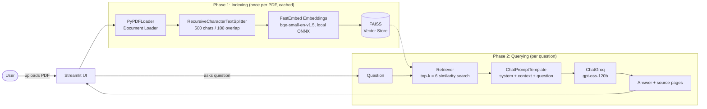
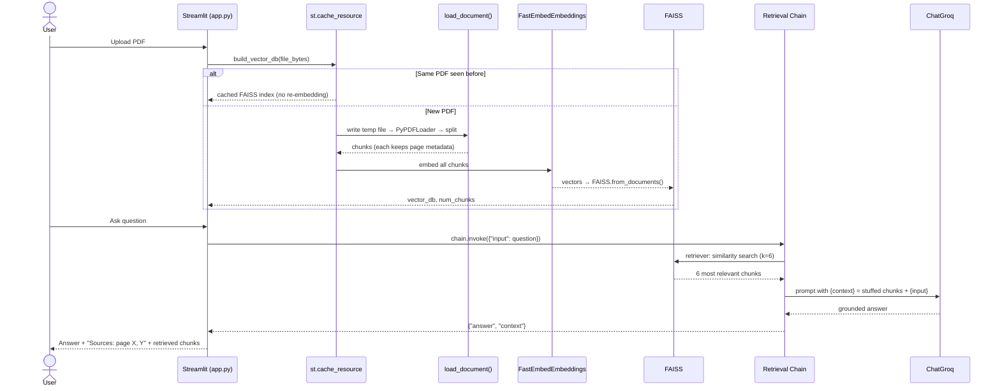

# AI-Powered PDF Q&A Assistant (RAG): Project Summary & Interview Guide

**Live app:** https://pdf-reader-using-langchain.streamlit.app/
**Stack:** Python · LangChain · Groq (`openai/gpt-oss-120b`) · FastEmbed (`BAAI/bge-small-en-v1.5`) · FAISS · PyPDF · Streamlit Cloud

---

## 1. The 30-second pitch

> "I built a Retrieval-Augmented Generation (RAG) app. A user uploads any PDF and asks questions in plain English. The app splits the PDF into overlapping chunks, converts them into vector embeddings with a **local** embedding model, and indexes them in **FAISS**. For each question it retrieves the 6 most similar chunks and passes them to a Groq-hosted LLM through a **LangChain retrieval chain**, so the answer is grounded in the document. It also shows the **source page numbers**. I made it production-friendly with caching, rate-limit handling and secrets management, and deployed it on Streamlit Cloud."

**Why RAG and not just an LLM?** An LLM doesn't know what's in *your* PDF and it hallucinates. RAG retrieves the relevant text first and tells the model to answer **only from that context**, so answers are factual, current and verifiable through citations.

---

## 2. High-Level Design (HLD)

The system has two phases: **indexing**, which runs once per PDF, and **querying**, which runs once per question.

| Layer | Component | Role |
|---|---|---|
| Presentation | Streamlit | Upload, question box, answer, citations, "show retrieved chunks" panel |
| Ingestion | `PyPDFLoader` + `RecursiveCharacterTextSplitter` | PDF → page `Document`s → small overlapping chunks |
| Embedding | `FastEmbedEmbeddings` (local) | Text → 384-dim vectors, free, no GPU, no API |
| Storage / search | FAISS (in-memory) | Fast nearest-neighbour similarity search |
| Generation | `ChatGroq` | Very fast LLM inference on Groq's LPU hardware |
| Orchestration | `create_retrieval_chain` + `create_stuff_documents_chain` | Connects retrieve → prompt → LLM |
| Ops | `st.cache_resource`, `st.secrets`, error handling | Speed, security, resilience |

---

## 3. Low-Level Design (LLD)

### 3.1 Request flow (sequence diagram)

### 3.2 Code map (click to jump to the code)

| What | Where | Key detail |
|---|---|---|
| Secrets loader | [app.py:23](app.py#L23) `get_secret()` | Reads `scripts/secret.py` locally or `st.secrets` on Streamlit Cloud. Keys are never committed (`.gitignore`). |
| Config | [app.py:51-53](app.py#L51-L53) | `LLM_MODEL`, `EMBEDDING_MODEL`, `NUM_CHUNKS = 6` |
| Embedding model (cached) | [app.py:60-64](app.py#L60-L64) `get_embeddings()` | Loaded **once** per server, not on every click |
| Indexing (cached on file bytes) | [app.py:74-91](app.py#L74-L91) `build_vector_db()` | Temp file → chunks → `FAISS.from_documents` |
| Chunking | [scripts/document_loader.py:22](scripts/document_loader.py#L22) | `chunk_size=500`, `chunk_overlap=100` |
| LLM (cached) | [app.py:94-96](app.py#L94-L96) `get_llm()` | `ChatGroq` client |
| Retriever | [app.py:114](app.py#L114) | `as_retriever(search_kwargs={"k": 6})` |
| Chain assembly | [app.py:130-131](app.py#L130-L131) | `create_stuff_documents_chain` → `create_retrieval_chain` |
| Rate-limit handling | [app.py:139](app.py#L139) | Catches 429 / `rate_limit` and shows a friendly message |
| Source citations | [app.py:150](app.py#L150) | Page numbers from chunk `metadata["page"]` |

---

## 4. Each step explained with LangChain terminology

| # | Step | LangChain concept | What to say in the interview |
|---|---|---|---|
| 1 | Load PDF | **Document Loader** (`PyPDFLoader`) | "Loaders turn raw sources into `Document` objects, which have `page_content` plus `metadata`. PyPDFLoader makes one Document per page and stores the page number in metadata, which I later use for citations." |
| 2 | Split | **Text Splitter** (`RecursiveCharacterTextSplitter`) | "It splits on paragraphs, then sentences, then words, so chunks stay semantically coherent. 500 characters keeps retrieval precise. The 100-character **overlap** stops a sentence that crosses a boundary from losing its context." |
| 3 | Embed | **Embeddings** (`FastEmbedEmbeddings`) | "An embedding maps text to a vector where similar meanings are close together. I used BGE-small through FastEmbed, which runs on ONNX: free, CPU-only, no PyTorch, about 70 MB, and no data leaves the server." |
| 4 | Store | **Vector Store** (`FAISS`) | "FAISS indexes the vectors for fast nearest-neighbour search. It's in-memory, which suits a single-document session." |
| 5 | Retrieve | **Retriever** (`vector_db.as_retriever(k=6)`) | "A retriever is a Runnable that takes a query and returns relevant Documents. It embeds the question with the *same* model and returns the top-6 chunks by similarity." |
| 6 | Prompt | **ChatPromptTemplate** | "A system message with a `{context}` placeholder and a human message with `{input}`. The instruction 'if you don't know, say you don't know' reduces hallucination." |
| 7 | Combine | **Stuff Documents Chain** (`create_stuff_documents_chain`) | "'Stuff' means all retrieved chunks are concatenated into the single `{context}` variable. It's the simplest strategy and works because 6×500 characters fits easily in the context window." |
| 8 | Orchestrate | **Retrieval Chain** (`create_retrieval_chain`) | "This connects the retriever and the stuff chain. One `.invoke({'input': q})` runs retrieve → prompt → LLM and returns `answer` **and** `context`, so I can show sources." |
| 9 | Generate | **Chat Model** (`ChatGroq`) | "LangChain's chat-model interface makes the LLM swappable. I moved from OpenAI to Groq by changing one class." |

---

## 5. Design decisions & trade-offs (the "why" questions)

| Decision | Why | Trade-off / alternative |
|---|---|---|
| **Local embeddings (FastEmbed)** instead of OpenAI embeddings | Zero cost, no API rate limits, privacy, no PyTorch, so it deploys easily on Streamlit Cloud's free tier | Slightly lower quality than large API models; first run downloads the model |
| **Groq** for the LLM | Very low latency, generous free tier, open-weight model | Rate limits on the free tier (handled in the code); a smaller fallback model is noted in config |
| **FAISS in-memory** | Fast, no infrastructure, ideal for one-PDF sessions | Not persistent or multi-user. For production: Pinecone, pgvector, Chroma or Qdrant |
| **Chunk 500 / overlap 100** | Small chunks = precise retrieval; overlap protects context at boundaries | Too small loses context, too large adds noise and cost; should be tuned with evaluation |
| **k = 6** | Enough context to cover multi-part answers without flooding the prompt | Higher k = better recall but more noise and tokens |
| **`st.cache_resource` keyed on file bytes** | Streamlit re-runs the whole script on every interaction; without the cache the PDF would be re-embedded for every question | Memory grows with many distinct PDFs |
| **"Stuff" strategy** | Simple, one LLM call, lowest latency | For very large contexts use map-reduce or refine chains |

---

## 6. Challenges I solved (good STAR stories)

1. **Re-embedding on every question:** Streamlit re-executes the script on each widget interaction. *Fix:* `@st.cache_resource` on the embedding model, the vector index (keyed on PDF bytes) and the LLM client. Each PDF is now embedded once.
2. **API rate limits (HTTP 429):** Groq's free tier and HuggingFace model downloads both rate-limit. *Fix:* catch 429 errors and show clear guidance, support an optional `HF_TOKEN`, and document a smaller fallback model.
3. **Secrets for local and cloud:** `get_secret()` checks a local git-ignored `secret.py` first, then `st.secrets` on Streamlit Cloud, then environment variables. API keys are never committed.
4. **Scanned / image-only PDFs:** no text means no chunks. *Fix:* detect empty output and tell the user, instead of crashing.
5. **LangChain 1.x migration:** classic chains moved to `langchain-classic`. *Fix:* a `try/except ImportError` keeps the code working on both versions.
6. **Trust:** the answer shows **page citations** and an expander with the exact retrieved chunks, which makes the system transparent and debuggable.

---

## 7. Limitations & how I'd improve it (shows maturity)

- **Hybrid search:** combine BM25 keyword search with dense vectors (`EnsembleRetriever`) for exact terms like IDs and names.
- **Re-ranking:** retrieve 20 chunks, then re-rank with a cross-encoder down to the best 5.
- **Query rewriting / multi-query:** `MultiQueryRetriever` generates paraphrases to improve recall.
- **Conversation memory:** `create_history_aware_retriever` so follow-up questions like "what about the second one?" work.
- **Evaluation:** use **RAGAS** metrics (faithfulness, answer relevancy, context precision/recall) to tune chunk size and k with data instead of guesswork.
- **Persistence & scale:** a persistent vector DB, multi-file support, OCR for scanned PDFs.
- **Streaming** the answer token by token for better perceived latency.

---

## 8. Likely interview questions (with short answers)

**Q: What is RAG?**
Retrieve relevant external knowledge at query time, put it into the prompt, and have the LLM generate an answer grounded in it. It's cheaper and fresher than fine-tuning, and it can cite sources.

**Q: How does similarity search work?**
The question is embedded with the same model as the chunks. FAISS finds the vectors closest to it (L2 distance or cosine similarity) and returns those chunks.

**Q: Why chunk at all?**
Context windows are limited, and a whole PDF would dilute relevance. Small chunks let retrieval pick precisely the relevant passages.

**Q: How do you reduce hallucination?**
Grounding prompt ("use the context; if unknown, say you don't know"), retrieved context only, citations, and an inspectable context panel.

**Q: RAG vs fine-tuning?**
RAG adds *knowledge* (dynamic, citable, cheap to update). Fine-tuning changes *behaviour or style*. For document Q&A, RAG is the right tool.

**Q: What is LCEL / a Runnable?**
LangChain Expression Language composes components with `|`. Every component (prompt, model, retriever, parser) is a *Runnable* with `.invoke`, `.batch` and `.stream`. `create_retrieval_chain` builds a Runnable pipeline for you.

**Q: How would you evaluate it?**
Build a small Q&A test set and measure faithfulness, answer relevancy and context precision/recall with RAGAS. Then tune chunk size, overlap, k and the embedding model.

---

## 9. Quick glossary

| Term | One-liner |
|---|---|
| Document | LangChain object: `page_content` + `metadata` |
| Chunk | A small piece of a document, used as the unit of retrieval |
| Embedding | A vector representation of meaning |
| Vector store | A database optimized for similarity search over embeddings (FAISS) |
| Retriever | Runnable: query → relevant Documents |
| Top-k | Number of chunks retrieved |
| Stuff chain | Puts all retrieved docs into one prompt |
| Grounding | Making the answer depend only on the provided context |
| Hallucination | A confident but unsupported answer |

> **Honesty note for interviews:** this project started from an open-source Streamlit RAG template (the README still credits the original author and describes the OpenAI version). Say so up front, then explain what **you** changed: you moved from OpenAI to **Groq + local FastEmbed embeddings**, added caching, page citations, rate-limit and error handling, secrets management, LangChain 1.x compatibility and Streamlit Cloud deployment. Interviewers respect clear ownership, and it gives you a good "what I improved and why" story. Consider updating the README so it matches the current code.
